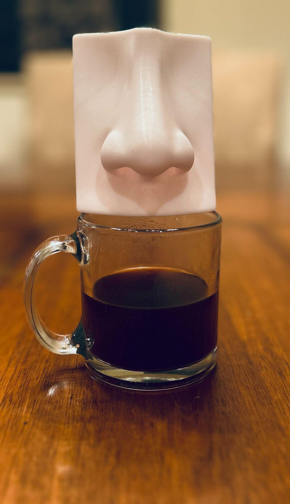
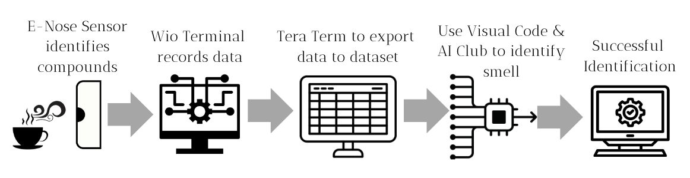
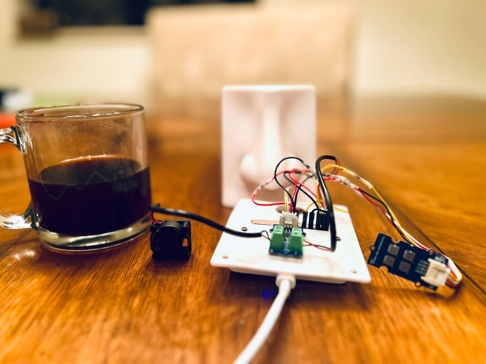
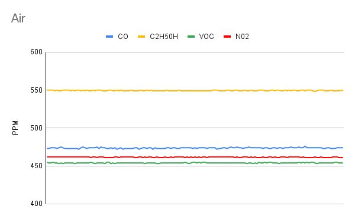
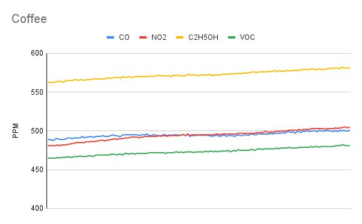
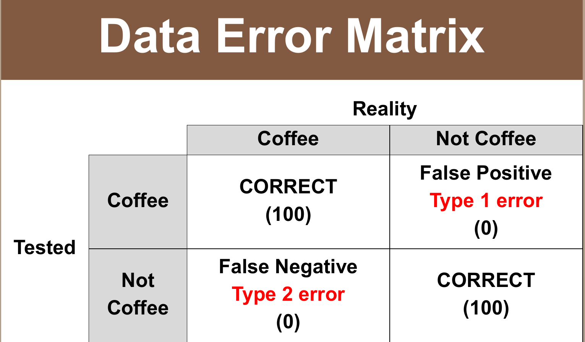
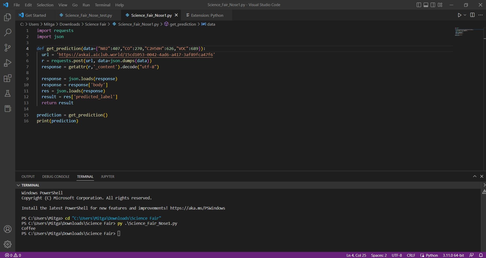
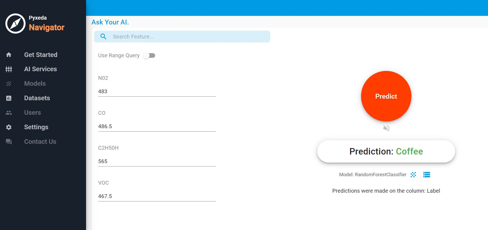
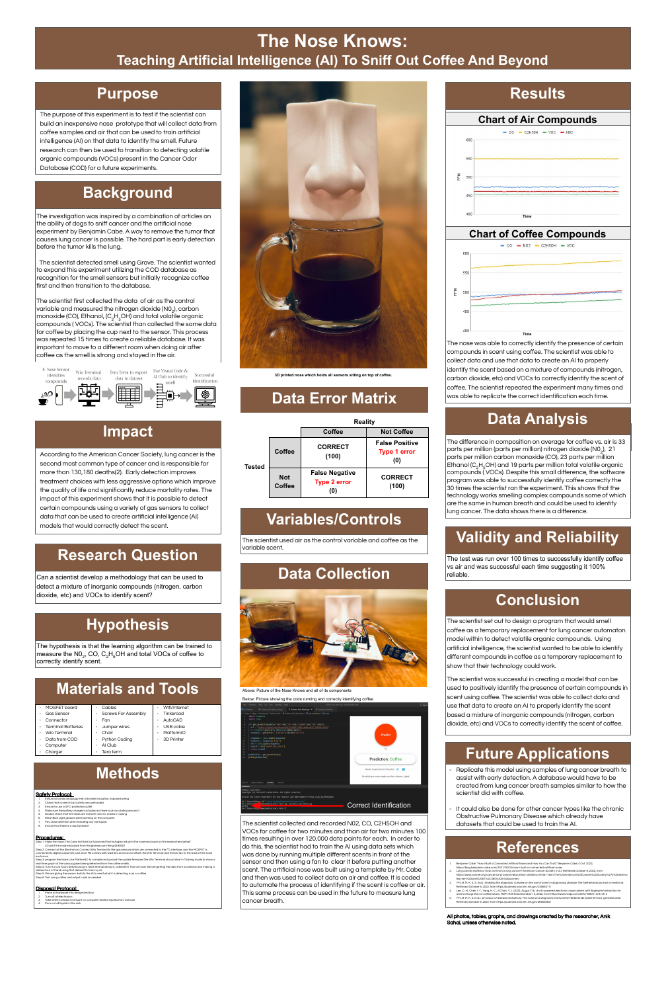

# The Nose Knows

**Teaching AI to sniff out coffee and beyond**

Anik Sahai · middle-school science fair project, 2023

[Poster PDF](poster/poster.pdf) · [Results](#results) · [Credits](#credits)

*The 3D-printed nose, which holds all of the sensors, sitting on a cup of coffee.*

---

## What this is

A low-cost electronic nose that reads four gas channels from the air above a sample, and a machine-learning model
trained on those readings to say whether it is smelling **coffee** or **plain air**.

Coffee was a stand-in. The question behind the project was whether a cheap sensor plus a trained model could pick
out a mixture of compounds by smell, as a first step toward detecting the volatile organic compounds (VOCs) linked to
disease.

## Why

The project started from two things: articles about dogs that can sniff out cancer, and Benjamin Cabé's open-source
[artificial nose](https://github.com/kartben/artificial-nose). Lung cancer is the second most common cancer and,
according to the American Cancer Society, is responsible for more than 130,180 deaths a year. A tumor can often be
removed when it is caught early; the hard part is catching it early. Early detection allows less aggressive treatment
and lowers mortality.

The long-term idea is to train the same kind of nose on the VOCs listed in the Cancer Odor Database (COD) and on
breath samples, for early lung-cancer screening. That work has **not** been done; see [What's next](#whats-next).

**Research question.** Can a scientist develop a method that detects a mixture of inorganic compounds and VOCs well
enough to identify a scent?

**Hypothesis.** A learning algorithm can be trained on NO2, CO, C2H5OH and total VOC readings to identify the smell
of coffee correctly.

## How it works

1. The gas sensor inside the nose reads four channels: nitrogen dioxide (NO2), carbon monoxide (CO), ethanol
   (C2H5OH) and total VOCs.
2. The Wio Terminal records the readings and shows a live graph of them.
3. Tera Term captures the serial output and saves it as a dataset.
4. The dataset trains a classifier on AI Club's platform. The poster's screenshots show a `RandomForestClassifier`
   in AI Club's Pyxeda Navigator, plus a short Python script in VS Code that sends one reading to the trained model
   and prints the predicted label.

*The nose and its components: back plate, MOSFET board, DC fan, and the Grove gas sensor.*

### Hardware

| Part | Role |
|---|---|
| Seeed **Wio Terminal** | Microcontroller with screen; reads the sensor and runs the firmware |
| **Grove Multichannel Gas Sensor v2** | Four channels: NO2, CO, C2H5OH, VOC |
| **MOSFET board** | Switches the fan from a digital pin |
| **DC fan** | Clears the chamber between samples |
| Wio Terminal battery chassis, charger, USB cable | Power |
| Grove connector, jumper wires, cables | Wiring |
| Short M2 screws, washers and nuts | Assembly |
| **3D-printed nose enclosure** | [thingiverse.com/thing:4493907](https://www.thingiverse.com/thing:4493907) |

Software listed on the poster: PlatformIO (firmware build and upload), Tera Term (serial capture), Python, AI Club,
Tinkercad and AutoCAD.

### Wiring summary

- The gas sensor connects to the Wio Terminal's **I²C** port.
- The MOSFET board is driven from digital output **D0** and switches the DC fan.
- The Wio Terminal and the fan mount on the back of the nose enclosure with short M2 screws, washers and nuts.

### Build steps

1. **Print the nose.** The Cane Institute for Advanced Technologies printed the enclosure from
   thingiverse.com/thing:4493907.
2. **Connect the electronics** as above.
3. **Program the nose.** Compile and upload the firmware with PlatformIO. The Wio Terminal starts in training mode
   and shows a real-time graph of the gases it detects.
4. **Warm up and train.** Power the nose on 24 hours before use to heat the sensors, then record data and build the
   training dataset from it.
5. **Classify.** Send new sensor readings to the model and check whether it reports air or coffee.
6. **Test with coffee** and adjust the code as needed.

## Data collection

Air was the control and coffee was the test scent.

- Air was recorded first: NO2, CO, C2H5OH and total VOCs.
- Coffee was then recorded the same way, with the cup placed next to the sensor.
- Each recording ran for two minutes, and the fan cleared the chamber between samples.
- The poster's Background section gives 15 repetitions of this process. The Data Collection section reports over
  120,000 data points for each class.
- After coffee, air had to be recorded in a different room, because the coffee smell was strong and stayed in the
  air.

## Results

### Sensor readings

<table>
<tr>
<td></td>
<td></td>
</tr>
<tr>
<td align="center"><em>Air</em></td>
<td align="center"><em>Coffee</em></td>
</tr>
</table>

With air, all four channels stay flat. With coffee, every channel reads higher and climbs slowly over the recording.
The poster reports these average differences between coffee and air (the units are as printed on the poster; the
sensor's raw output is not a calibrated concentration):

| Channel | Coffee minus air |
|---|---|
| NO2 | 33 |
| CO | 21 |
| C2H5OH | 23 |
| Total VOC | 19 |

### Classification

| | Really coffee | Really not coffee |
|---|---|---|
| **Classified coffee** | 100 correct | 0 false positives |
| **Classified not coffee** | 0 false negatives | 100 correct |

On the poster's test set, the model got every coffee and every air sample right. The poster gives different counts
for how many times the test was run (30 times in Data Analysis, over 100 in Validity and Reliability), and the matrix
shows 100 per class. The original data and training code no longer exist, so the split between training and test
data can't be checked. Treat the result as one coffee-vs-air setup working, not as a general accuracy figure.

<table>
<tr>
<td></td>
<td></td>
</tr>
<tr>
<td align="center"><em>Python script querying the trained model</em></td>
<td align="center"><em>The same model in AI Club's Navigator</em></td>
</tr>
</table>

## What's next

- **Lung cancer.** Repeat the method on lung-cancer breath samples, starting with VOCs from the Cancer Odor
  Database. That needs a breath-sample dataset, built the way the coffee dataset was.
- **Other diseases.** Chronic obstructive pulmonary disease (COPD) already has datasets that could train the model.
- **Harder tests.** More than two classes, held-out sessions on different days and in different rooms, and calibrated
  sensors.

None of this has been done yet.

## Poster

## Credits

- **Firmware and enclosure design** come from Benjamin Cabé's open-source
  [artificial nose](https://github.com/kartben/artificial-nose)
  ([write-up](https://blog.benjamin-cabe.com/2021/08/03/how-i-built-a-connected-artificial-nose)) and the
  [Thingiverse enclosure](https://www.thingiverse.com/thing:4493907). This project used them as a template; it did
  not write them.
- **3D printing** by the Cane Institute for Advanced Technologies.
- **Model training** ran on AI Club's platform.
- **Not preserved:** the original training code, the dataset and the trained model weren't kept. This repository
  holds the write-up, the poster, and the photos and charts from it. Nothing here was recreated after the fact.

All photos, tables, graphs and drawings are by Anik Sahai unless noted otherwise.

### References (from the poster)

1. B. Cabé, "How I Built a Connected Artificial Nose (and How You Can Too!)," 2021.
   https://blog.benjamin-cabe.com/2021/08/03/how-i-built-a-connected-artificial-nose
2. American Cancer Society, "Lung cancer statistics: How common is lung cancer?" Retrieved Oct 9, 2022.
   https://www.cancer.org/cancer/lung-cancer/about/key-statistics.html
3. "Smelling the diagnosis: A review on the use of scent in diagnosing disease," *The Netherlands Journal of
   Medicine*. https://pubmed.ncbi.nlm.nih.gov/23956311/
4. C.-H. Lee, I.-T. Chen, H.-C. Yang and Y. J. Chen, "An AI-powered electronic nose system with fingerprint
   extraction for aroma recognition of coffee beans," *Micromachines* 13(8):1313, 2022.
   https://www.mdpi.com/2072-666X/13/8/1313
5. "An odour of disease and decay: The nose as a diagnostic instrument," *Nederlands Tijdschrift voor Geneeskunde*.
   https://pubmed.ncbi.nlm.nih.gov/26606582/

## License

The write-up, photos and poster are released under the [MIT License](LICENSE). Cabé's firmware and enclosure keep
their own licenses.
